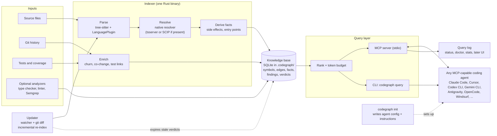

# codegraph

A local code knowledge graph for coding agents. It indexes your repository on your own machine and lets any MCP-capable agent look up where things are, what calls what, what could break, and what has already been checked, so the agent reads the right 30 lines instead of 30 files.

> **Status: planning.** This README describes the target design, and not everything below is built yet. See [STATUS.md](STATUS.md) for what works today and [PLAN.md](PLAN.md) for the build plan.

It is built for agents, not humans: results are dense, token-budgeted text with exact `file:line` ranges and a confidence tag (`certain`, `inferred`, `unknown`) on every relationship.

## How it works



If your viewer does not render Mermaid, see [docs/architecture.svg](docs/architecture.svg).

1. The indexer parses your code (tree-sitter), resolves names, derives facts such as side effects and entry points, and adds git and test information.
2. Everything is stored in a local SQLite file in `.codegraph/`. Each fact is tied to the hash of the code it describes, so when the code changes, stale facts expire instead of misleading the agent.
3. The updater watches for changes and re-indexes only what changed.
4. Agents query it through a standard MCP server (or the CLI) and get ranked, size-capped answers.
5. Nothing leaves your machine.

## Install

One command. No Node, npm, Python or Rust needed. It installs a single binary into your user folder and needs no admin rights.

macOS and Linux:

```sh
curl -fsSL https://<your-domain>/install.sh | sh
```

Windows (PowerShell):

```powershell
irm https://<your-domain>/install.ps1 | iex
```

You can read the scripts first: they live in [`install/`](install/). The installer verifies a SHA-256 checksum, prints what it does, and supports `--uninstall`.

## Connect your coding agent

From your project folder:

```sh
codegraph init
```

This indexes the repo, detects the coding agents installed on your machine, shows exactly what it will change in each agent's MCP config, and asks before applying. To target one agent, run `codegraph init --agent <name>`. To undo, run `codegraph agents remove <name>`.

Most agents need a **restart or reload** afterwards, and some ask you to **approve** the new server. `codegraph init` prints the exact steps for each agent it configures.

### Check that it works

```sh
codegraph doctor
```

`doctor` connects to codegraph's own server as an MCP client and reports, per agent, what is wrong: config missing, wrong path, server crashing, tools hidden, or index stale. Then ask your agent:

> Use codegraph to find where login is handled and what calls it.

You should see it call a `codegraph` tool instead of opening many files.

### Supported agents

The `codegraph` MCP server works with any MCP-capable client — that is the only integration surface. `codegraph init` detects the agents below from PATH and config markers, shows the exact change to each config, and asks before writing. Config formats were re-verified against each agent's official docs on 2026-11-19; statuses reflect real-install verification (see [COMPAT.md](COMPAT.md)). Per-agent setup guides under `docs/agents/` are generated from the same adapter table in phase 2.6 and are not available yet — until then, `codegraph init` prints each agent's exact steps on setup, and manual setup is documented in [COMPAT.md](COMPAT.md).

| Agent | Setup | Status |
|---|---|---|
| Claude Code (CLI, desktop app, IDE extensions) | `codegraph init --agent claude-code` | verified 2026-11-19 (pending interactive approval on first project-scope run) |
| Cursor | `codegraph init --agent cursor` | unverified |
| VS Code with GitHub Copilot | `codegraph init --agent vscode-copilot` | unverified |
| Codex CLI | `codegraph init --agent codex-cli` | unverified |
| Gemini CLI | `codegraph init --agent gemini-cli` | unverified |
| Google Antigravity (IDE and CLI) | `codegraph init --agent antigravity` (user scope recommended) | unverified |
| OpenCode | `codegraph init --agent opencode` | verified 2026-11-19 (`opencode mcp list` → connected) |
| Windsurf / Devin Desktop | `codegraph init --agent windsurf` | unverified |
| Claude Desktop | `codegraph init --agent claude-desktop` (user scope only) | unverified |

### Any other MCP client

`codegraph mcp-config --format json` (or `toml`, `yaml`) prints a snippet for your client with the right command path. The shape differs between agents (for example, OpenCode takes `command` as an array and Codex uses TOML), so prefer that output over copying an example. A typical JSON entry looks like this:

```json
{
  "mcpServers": {
    "codegraph": {
      "command": "/absolute/path/to/codegraph",
      "args": ["serve"]
    }
  }
}
```

If your agent has a shell tool but no MCP support, it can call the same tools from the command line: `codegraph query <tool> <args>`.

## Commands

| Command | What it does |
|---|---|
| `codegraph init` | Index the repo, detect agents, and set them up (asks first) |
| `codegraph index` | Build or refresh the index |
| `codegraph serve` | Run the MCP server on stdio (agents launch this) |
| `codegraph status` | Index health: files and symbols, indexed commit vs HEAD, gaps, active enhancers, connected agents |
| `codegraph doctor` | Diagnose setup problems per agent |
| `codegraph stats` | Queries served per agent, latency, and tokens returned |
| `codegraph query <tool> <args>` | Call a tool from the command line |
| `codegraph agents list` | List Tier 1 agents and whether they are detected/configured, per scope |
| `codegraph agents remove <id>` | Undo setup: restores the pre-install config bytes; removes the instruction block |
| `codegraph agents doctor` | Diagnose setup problems per agent, each finding with a fix (alias: `codegraph doctor`) |
| `codegraph mcp-config` | Print a config snippet for any MCP client |
| `codegraph update` | Update the binary |

## Privacy

codegraph runs on your machine. It makes no network calls except installing and updating the binary and downloads you explicitly enable (optional analyzers, embedding models). The query log records metadata only (tool, agent, result size, latency), never your source code or query text, and it stays local.

## Project documents

- [PLAN.md](PLAN.md): build plan and acceptance checks
- [STATUS.md](STATUS.md): current state
- [DECISIONS.md](DECISIONS.md): why things are the way they are
- [COMPAT.md](COMPAT.md): agent compatibility matrix
